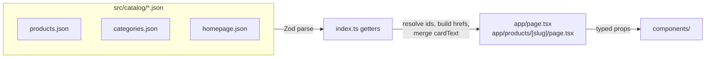

# Architecture

How the Octopus demo is built: where content lives, how it reaches the pages, and the conventions the components follow. For setup, trade-offs and design assumptions, see the [README](README.md).

## Stack

| Concern      | Choice                                                                  |
| ------------ | ----------------------------------------------------------------------- |
| Framework    | Next.js 16, App Router, every page prerendered at build                 |
| UI           | React 19 Server Components, with small client islands                   |
| Language     | TypeScript, `strict`                                                    |
| Styling      | Tailwind CSS 4, Figma tokens in the `@theme` of `globals.css`           |
| Content      | Local JSON, validated with Zod at build                                 |
| Interactions | Embla (carousel), Radix Dialog (mobile menu), Radix Accordion (specs)   |
| Icons, font  | Lucide, self-hosted Satoshi variable font through `next/font/local`     |
| Tests        | Vitest + Testing Library on happy-dom; Playwright on a production build |
| Hosting      | Vercel                                                                  |

## Folder map

```
src/
├── app/                     Routes (App Router)
│   ├── layout.tsx           Root layout: font, Header, Footer, default metadata
│   ├── page.tsx             /                  Homepage
│   ├── products/[slug]/     /products/:slug    Product page, one per product
│   ├── coming-soon/         /coming-soon       Target of every link outside the demo
│   └── globals.css          Design tokens and custom utilities
├── catalog/                 Content and its only access layer
│   ├── products.json        Every product: card fields + page content + optional SEO
│   ├── categories.json      Category ids and names
│   ├── homepage.json        Hero, SEO, category sections, tiles, « Find us at »
│   ├── schema.ts            Zod schemas and the types inferred from them
│   └── index.ts             Async getters the pages call
├── components/              One component per Figma component, shared by both pages
├── lib/                     Small framework-free helpers (breakpoints, image sizes, metadata, site URL)
├── navigation.ts            Header and footer links (all lead to /coming-soon for now)
├── fonts/                   Satoshi-Variable.woff2
└── test/fixtures.ts         makeProduct() for component tests
e2e/                         Playwright specs + shared helpers (support.ts)
public/                      Images (products, category crops, banners, logos, OG) and the PDF manual
docs/                        SPEC.md and the tickets the work was cut into
```

Imports use the `@/` alias for `src/`.

## Data flow



1. **Raw JSON** is imported statically by `src/catalog/index.ts`.
2. **Validation.** Each getter parses its file with the schema from `schema.ts`. A failure throws `Invalid <label> data:` followed by `z.prettifyError`, which names the path of the bad field, so a bad edit fails `yarn build`. Schemas also reject repeated ids, slugs, colours and tiles, and require site paths to start with `/`.
3. **Resolution.** Content files store references as ids; the getters turn them into the shapes the components want:
   - a product's `category` id becomes a `Category` object, and the product gains `href` (`/products/<slug>`);
   - a Homepage section's `featured` / `products` ids become `Product` objects. The product must exist **and** belong to the section's category, or the build fails;
   - a section's optional `cardText` overrides a card's `name` / `shortDescription` for that section only. Card text for a product the section does not show fails the build;
   - category tiles get their `Category` and an `href`.
4. **Pages** call the getters (in `Promise.all`) and hand typed data to components. Components never import JSON or the catalog getters, only the catalog **types**.

There are two families of types in `schema.ts`: `*Content` types mirror the JSON (ids as strings), and `*Data` types / `Product` are the resolved shapes after step 3.

### Catalog API (`src/catalog/index.ts`)

| Getter                   | Returns                                                                                       | Used by       |
| ------------------------ | --------------------------------------------------------------------------------------------- | ------------- |
| `getHomepage()`          | Parsed `homepage.json`                                                                        | Homepage, SEO |
| `getProducts()`          | All products, category resolved, `href` added                                                 | other getters |
| `getBestSellers()`       | Products with `bestSeller: true`, in `products.json` order                                    | both pages    |
| `getProduct(slug)`       | One product or `undefined`                                                                    | product page  |
| `getProductSlugs()`      | Every slug, for `generateStaticParams`                                                        | product page  |
| `getProductSeo(product)` | Product SEO, each missing field falling back to name, short description, Homepage share image | product page  |
| `getCategorySections()`  | Resolved Homepage sections (`CategorySectionData[]`)                                          | Homepage      |
| `getExploreCategories()` | Resolved « Explore all categories » tiles                                                     | Homepage      |

The getters are `async` although they read local files: that keeps the same signatures when a CMS replaces the JSON, so only this file would change. The pure `parse*` / `build*` functions are exported separately so unit tests can feed them inline data.

### Content model

- **One record per product** (`products.json`) holds both what cards show (name, category, short description, image, `bestSeller`) and what its page shows (description, colours, `gallery`, `specs`, `downloads`, `seo`). `gallery`, `specs`, `downloads` and `seo` are optional; the page renders what is present.
- **`gallery`** is an ordered list of blocks, a discriminated union on `type`: `photo` (one image) or `features` (a group of feature cards).
- **Homepage sections** are a discriminated union on `layout`:
  - `featured-above` / `featured-beside`: a large card with an art-directed photo plus medium cards;
  - `banner`: one full-width product banner;
  - `cards`: a row of small cards.
    Sections are **curated**: a product appears on the Homepage only when its id is listed in a section.
- **Art-directed photos** (`PhotoCrops`) carry one crop per breakpoint, an alt and a `backdrop` colour used behind the text.

## Routes and rendering

| Route              | File                           | Rendering                                                                            |
| ------------------ | ------------------------------ | ------------------------------------------------------------------------------------ |
| `/`                | `app/page.tsx`                 | Static                                                                               |
| `/products/[slug]` | `app/products/[slug]/page.tsx` | SSG via `generateStaticParams`; `dynamicParams = false`, so an unknown slug is a 404 |
| `/coming-soon`     | `app/coming-soon/page.tsx`     | Static, `noindex`                                                                    |

`RootLayout` wraps every page with `Header` and `Footer` and sets `metadataBase` and the title template. `PageProps<…>` and `LayoutProps<…>` are the route-typed helpers generated by `next typegen` (run by `yarn typecheck`).

### Page composition

```
Homepage (main)
├── Hero                     hero.video optional; gray gradient placeholder until a video is set
├── BestSellers cards="large"  → Carousel of FeaturedProductCard
├── CategorySection × n      layout picks: HighlightProductCard + MediumProductCard,
│                            ProductBanner, or ProductCard grid
├── ExploreCategories        category tiles → /coming-soon
└── FindUsBanner             ArtDirectedImage + WarehouseLogo

Product page (main)
├── ProductHero              photo, name, ColorSelector, « Where to buy »; children go in its column:
│   ├── ProductGallery       photo blocks + FeatureCards
│   └── ProductDetails       Accordion of specs + Downloads card
├── BestSellers cards="small"  → Carousel of PopularProductCard
└── WhereToBuyBar            fixed bar below tablet
```

`BestSellers` is the same component on both pages; the `cards` prop selects the card component, spacing and whether it animates from a `layouts` table.

## Components

### Server by default, client islands

Every component is a Server Component unless it needs the browser. The client islands are:

| Component       | Why it runs in the browser                                              |
| --------------- | ----------------------------------------------------------------------- |
| `Carousel`      | Embla instance, arrows, dots, reduced-motion handling                   |
| `MobileMenu`    | Radix Dialog state; closes itself when the window reaches desktop width |
| `Accordion`     | Radix Accordion                                                         |
| `ColorSelector` | Selected swatch state                                                   |
| `Reveal`        | `IntersectionObserver` for scroll-in animations                         |

Server components pass server-rendered children into these islands (for example cards into `Carousel`), so the card markup itself ships no JavaScript.

### Building blocks

- **`Button` / `ButtonLink`**: the Figma button variants; `ButtonLink` wraps `next/link`. `ghostTextClasses` is shared with links that look like ghost buttons.
- **`Icon`**: maps a fixed set of names to Lucide icons at 16 or 24 px; decorative unless given a `label`.
- **`ResponsiveImage`**: `next/image` with a `sizes` object (`{ mobile, tablet?, desktop? }`) turned into a `sizes` attribute by `lib/imageSizes.ts`.
- **`ArtDirectedImage`**: a `<picture>` with one `<source>` per breakpoint, built from `getImageProps`, so each breakpoint loads its own crop with Next's optimised `srcSet`. Fills its positioned parent.
- **`SectionHeader`**, **`LearnMoreLink`**, **`HeaderLogoLink`**, **`WarehouseLogo`**: small shared pieces.
- **Product cards** (`FeaturedProductCard`, `PopularProductCard`, `ProductCard`, `MediumProductCard`, `HighlightProductCard`, `ProductBanner`) each match one Figma card and all take a resolved `Product`.

## Styling

- **Tokens.** `globals.css` resets Tailwind's default colours, text sizes and breakpoints (`--color-*: initial`, …) and defines only the Figma ones: colours, type scale, spacing, radii, shadow, easing. Classes like `bg-card`, `text-text-secondary` or `rounded-card` therefore only exist if Figma has the token.
- **Breakpoints.** Two, named after the Figma frames: `tablet` (50.625rem / 810 px) and `desktop` (75rem / 1200 px), mobile-first. The same values live in `lib/breakpoints.ts` for media queries in JS (`<picture>` sources, `sizes`, `matchMedia`). **Change both together.**
- **Custom utilities** (`@utility`): `page-container` (max width and side padding per breakpoint), type styles that change size per breakpoint (`heading-1/2/3`, `section-title`, `subtitle`), `navbar-surface`, `focus-ring`, `fade-backdrop` (eased fade of the `--backdrop` colour set by `lib/backdrop.ts`), `gallery-block-height`, `text-trim-cap`, and the `reveal` animation.
- **Class composition** uses `lib/cx.ts`, a three-line join of truthy strings; no `clsx` or `tailwind-merge`.
- **Layout details.** The header floats over the page, so the Homepage hero pulls itself up with `-mt-header`. When the page contains `[data-where-to-buy-bar]`, `body:has(...)` adds bottom padding below tablet so the fixed bar never hides the footer.

## Motion

`Reveal` wraps a block and sets `data-reveal` to `pending`, `hidden` or `shown` as it enters the viewport; descendants with the `reveal` class fade and slide in (`reveal-text` uses a shorter travel). The CSS only hides content when scripting is enabled and on screen, shows it after 3 s if the script never runs, and drops the slide under `prefers-reduced-motion`. The carousel also honours reduced motion.

## SEO and metadata

- `lib/metadata.ts` → `pageMetadata(seo, path)` builds the title (absolute), description, canonical URL, Open Graph and Twitter card from a `Seo` object.
- The Homepage takes its `Seo` from `homepage.json`; a product page from `getProductSeo`.
- `lib/site.ts` → `getSiteUrl()` sets `metadataBase` from Vercel env vars (`VERCEL_PROJECT_PRODUCTION_URL` in production, the branch or deployment URL on previews), falling back to `http://localhost:$PORT`. OG URLs are therefore absolute on every environment.

## Accessibility conventions

- Each section is a `<section aria-labelledby>` pointing at its heading (ids from `useId`); the banner section keeps an `sr-only` heading.
- Repeated link text gets an `sr-only` suffix (« Explore all products _in Kitchen_ », « Learn more _about <product>_ »).
- Focus is drawn by the `focus-ring` utility at full opacity; white on the red banner.
- Radix supplies focus trapping, Escape and ARIA state for the menu and accordion.
- Decorative images take an empty alt; schema requires a non-empty alt where the image carries meaning (gallery photos, SEO images).

## Testing

| Layer      | Tool                                | Where                       | Covers                                                                                                                      |
| ---------- | ----------------------------------- | --------------------------- | --------------------------------------------------------------------------------------------------------------------------- |
| Content    | Vitest                              | `src/catalog/*.test.ts`     | Schemas, id resolution, card text rules, tiles; `getProduct` on the real JSON                                               |
| Components | Vitest + Testing Library, happy-dom | `src/components/*.test.tsx` | Rendering from props built with `makeProduct()`, interactions                                                               |
| End to end | Playwright (Chromium)               | `e2e/*.spec.ts`             | Navigation and menu, carousel swipe, layout per width, no horizontal scroll, no layout shift, no broken link, SEO tags, 404 |

- `vitest.setup.ts` mocks `next/image` to render the plain `` Next would produce, since happy-dom does no layout.
- Playwright builds and starts the app on port 3100 (`yarn build && yarn start`), so end-to-end tests run against production output.
- E2E specs read product names and copy from the page or follow links found on it rather than hard-coding them, so they survive content changes.

## Tooling and workflow

- `yarn typecheck` = `next typegen && tsc --noEmit`.
- Husky `pre-commit` runs `lint-staged` (ESLint `--fix` + Prettier on staged files) then `yarn typecheck`.
- ESLint uses `eslint-config-next` (core web vitals + TypeScript).
- `next.config.ts` wires the Tailwind Turbopack loader and allows one LAN origin so a phone can load the dev server.

## Extending

- **Add a product**: add an entry to `products.json` (and its image in `public/images/products/`). It gets a page at `/products/<slug>` automatically; set `bestSeller: true` to put it in « Best sellers », and list its id in a `homepage.json` section to show it there.
- **Add a Homepage section**: add an entry to `sections` with one of the existing layouts. A new layout means a new member in `categorySectionSchema`, a branch in `buildCategorySection`, and one in `CategorySection`.
- **Move to a CMS**: replace the JSON reads in `src/catalog/index.ts` (keeping the Zod parse at the boundary), switch images to remote patterns, and add on-demand revalidation. Pages and components keep their props.
